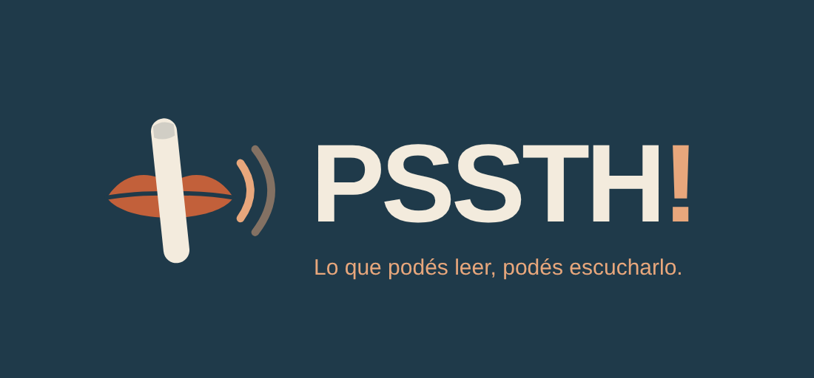

# Ficha de App Store — PSSTH!

Icono: `assets/icon.png` (1024×1024). Logo horizontal: `tienda/logo_horizontal.png`. Fuente vectorial: `assets/logo.svg`, `assets/logo_horizontal.svg`. Colores: fondo #1F3A4A, labios #C2603A, dedo #F3EBDD, acento #E8A77C.

## Nombre
PSSTH!

## Subtítulo (30 caracteres máx.)
Escucha tus documentos

## Descripción
PSSTH! convierte cualquier documento en una experiencia de audiolibro: abre un PDF, una foto, un texto o un EPUB, pulsa Play y escucha.

- Lee PDFs con texto y PDFs escaneados (reconocimiento de texto en el dispositivo).
- Fotos y capturas: apunta con la cámara a una hoja y escúchala.
- Escanear a PDF: fotografía varias páginas y obtén un PDF con texto buscable para guardarlo o compartirlo.
- Graba clases o conversaciones y conviértelas en texto para escucharlas y buscarlas (transcripción en el dispositivo).
- Importa varios documentos a la vez (hasta 50).
- Reproducción en segundo plano y con la pantalla bloqueada; controles desde la pantalla de bloqueo y los auriculares.
- Guarda el progreso y continúa donde lo dejaste.
- Velocidad y voz a tu gusto; detección automática del idioma.
- Marcadores, búsqueda, capítulos, temporizador de sueño y exportación del texto.
- Lectura natural de textos jurídicos y contables: artículos, incisos, importes y porcentajes.
- Diccionario de pronunciación para nombres, siglas y términos técnicos.

Privacidad: lo básico se procesa en tu dispositivo y funciona sin Internet. Sin cuentas obligatorias ni anuncios. Lo que se conecta es opcional y solo si lo activas: descargar voces y modelos, sincronizar con tu Google Drive, o resumir y transcribir hojas con DeepSeek usando tu propia clave.

Opcional para usuarios avanzados: corrección del texto con un modelo Ollama en tu propio ordenador, dentro de tu red (desactivada por defecto).

Nota: el reconocimiento de texto y la voz pueden contener errores; consulta el documento original para cualquier uso formal.

## Palabras clave (100 caracteres máx.)
lector,pdf,audiolibro,voz,escuchar,texto a voz,ocr,leer,documentos,epub

## Categoría
Productividad (secundaria: Educación)

## Clasificación por edades
4+

## Privacidad de la app (cuestionario de App Store Connect)
PENDIENTE DE REVISAR antes de enviar: el desarrollador no recibe datos ni hace seguimiento, pero con la clave de DeepSeek de la persona salen textos y fotos de hojas hacia DeepSeek, y con la sincronización los datos van a su propio Google Drive. Confirmar en el cuestionario de App Store Connect si eso cuenta como datos recopilados por terceros. La IA de la computadora (Ollama) envía texto solo al servidor que el usuario configura.

## URL de política de privacidad
https://cartagenacorrealimitada-cell.github.io/pssth-privacidad/

## URL de soporte
Misma página, sección "Contacto".

## Capturas de pantalla (pendiente del iPhone)
Necesarias: iPhone 6,7" (1290×2796) y opcionalmente 6,5". Tomarlas en el iPhone real con:
1. Biblioteca con "Continuar escuchando".
2. Reproductor leyendo un documento (texto resaltado).
3. Pantalla de bloqueo con los controles.
4. Cámara/foto reconocida.
5. Capítulos o marcadores.

## Notas para la revisión de Apple
La app no requiere cuenta. Para probar: abrir cualquier PDF desde Archivos con "Abrir en PSSTH!" y pulsar Play. El permiso de cámara/fotos solo se solicita al usar esas funciones (incluido «Escanear a PDF», que crea el PDF en el dispositivo y solo lo entrega por la hoja Compartir); el de micrófono y reconocimiento de voz, solo al pulsar «Grabar clase o conversación» (la transcripción se hace en el dispositivo). Los modelos opcionales de voz natural y transcripción se descargan desde GitHub en «Voces y modelos» y no son necesarios para probar la app. La "Corrección avanzada (IA local)" está desactivada por defecto, necesita un servidor Ollama propio del usuario en su red y no es necesaria para probar la app; el permiso de red local solo se solicita al activarla.

## Texto de los permisos (ya en Info.plist)
- NSCameraUsageDescription: "PSSTH! usa la cámara para fotografiar páginas y leerlas en voz alta. Las fotos se procesan en tu dispositivo; solo si pones tu clave de DeepSeek, las hojas que transcribes se envían a DeepSeek."
- NSPhotoLibraryUsageDescription: "PSSTH! necesita acceder a tus fotos para leer en voz alta el texto de una imagen. Se procesa en tu dispositivo; solo si pones tu clave de DeepSeek, las hojas que transcribes se envían a DeepSeek."
- NSMicrophoneUsageDescription: "PSSTH! usa el micrófono para grabar clases o conversaciones. El audio se guarda y se transcribe solo en tu dispositivo."
- NSSpeechRecognitionUsageDescription: "PSSTH! transcribe tus grabaciones con el reconocimiento de voz del iPhone, sin enviarlas a ningún servidor."
- NSLocalNetworkUsageDescription: "PSSTH! se conecta a tu propio ordenador en la red local solo si conectas la IA de tu computadora."
