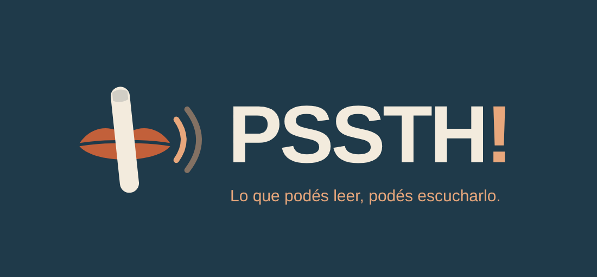

# Ficha de App Store — PSSTH!

Icono: `assets/icon.png` (1024×1024). Logo horizontal: `tienda/logo_horizontal.png`. Fuente vectorial: `assets/logo.svg`, `assets/logo_horizontal.svg`. Colores: fondo #1F3A4A, labios #C2603A, dedo #F3EBDD, acento #E8A77C.

## Nombre
PSSTH!

## Subtítulo (30 caracteres máx.)
Escucha tus documentos

## Descripción
PSSTH! convierte cualquier documento en una experiencia de audiolibro: abre un PDF, una foto, un texto o un EPUB, pulsa Play y escucha.

- Lee PDFs con texto y PDFs escaneados (reconocimiento de texto en el dispositivo).
- Fotos y capturas: apunta con la cámara a una hoja y escúchala.
- Graba clases o conversaciones y conviértelas en texto para escucharlas y buscarlas (transcripción en el dispositivo).
- Importa varios documentos a la vez (hasta 50).
- Reproducción en segundo plano y con la pantalla bloqueada; controles desde la pantalla de bloqueo y los auriculares.
- Guarda el progreso y continúa donde lo dejaste.
- Velocidad y voz a tu gusto; detección automática del idioma.
- Marcadores, búsqueda, capítulos, temporizador de sueño y exportación del texto.
- Lectura natural de textos jurídicos y contables: artículos, incisos, importes y porcentajes.
- Diccionario de pronunciación para nombres, siglas y términos técnicos.

Privacidad total: todo se procesa en tu dispositivo. Sin cuentas ni anuncios, y funciona sin Internet; solo se conecta si eliges descargar las voces o la transcripción opcionales.

Opcional para usuarios avanzados: corrección del texto con un modelo Ollama en tu propio ordenador, dentro de tu red (desactivada por defecto).

Nota: el reconocimiento de texto y la voz pueden contener errores; consulta el documento original para cualquier uso formal.

## Palabras clave (100 caracteres máx.)
lector,pdf,audiolibro,voz,escuchar,texto a voz,ocr,leer,documentos,epub

## Categoría
Productividad (secundaria: Educación)

## Clasificación por edades
4+

## Privacidad de la app (cuestionario de App Store Connect)
Datos recopilados: **Ninguno** ("Data Not Collected"). PSSTH! no recopila datos vinculados ni no vinculados al usuario y no realiza seguimiento. La corrección opcional con Ollama envía texto solo al servidor que el usuario configura (normalmente su propio ordenador); el desarrollador no recibe esos datos.

## URL de política de privacidad
Publicar tienda/PRIVACIDAD.md en una página pública (por ejemplo GitHub Pages de un repositorio público pequeño) y usar esa URL.

## URL de soporte
Misma página, sección "Contacto".

## Capturas de pantalla (pendiente del iPhone)
Necesarias: iPhone 6,7" (1290×2796) y opcionalmente 6,5". Tomarlas en el iPhone real con:
1. Biblioteca con "Continuar escuchando".
2. Reproductor leyendo un documento (texto resaltado).
3. Pantalla de bloqueo con los controles.
4. Cámara/foto reconocida.
5. Capítulos o marcadores.

## Notas para la revisión de Apple
La app no requiere cuenta. Para probar: abrir cualquier PDF desde Archivos con "Abrir en PSSTH!" y pulsar Play. El permiso de cámara/fotos solo se solicita al usar esas funciones; el de micrófono y reconocimiento de voz, solo al pulsar «Grabar clase o conversación» (la transcripción se hace en el dispositivo). Los modelos opcionales de voz natural y transcripción se descargan desde GitHub en «Voces y modelos» y no son necesarios para probar la app. La "Corrección avanzada (IA local)" está desactivada por defecto, necesita un servidor Ollama propio del usuario en su red y no es necesaria para probar la app; el permiso de red local solo se solicita al activarla.

## Texto de los permisos (ya en Info.plist)
- NSCameraUsageDescription: "PSSTH! usa la cámara para fotografiar páginas y leerlas en voz alta. Las fotos se procesan solo en tu dispositivo."
- NSPhotoLibraryUsageDescription: "PSSTH! necesita acceder a tus fotos para leer en voz alta el texto de una imagen. Se procesa solo en tu dispositivo."
- NSMicrophoneUsageDescription: "PSSTH! usa el micrófono para grabar clases o conversaciones. El audio se guarda y se transcribe solo en tu dispositivo."
- NSSpeechRecognitionUsageDescription: "PSSTH! transcribe tus grabaciones con el reconocimiento de voz del iPhone, sin enviarlas a ningún servidor."
- NSLocalNetworkUsageDescription: "PSSTH! se conecta a tu propio ordenador en la red local solo si activas la corrección avanzada con Ollama."
